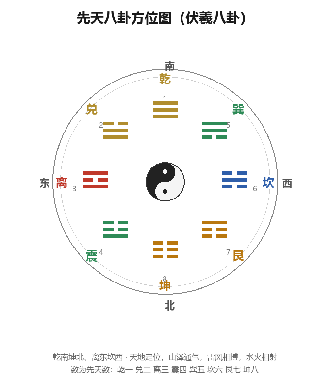
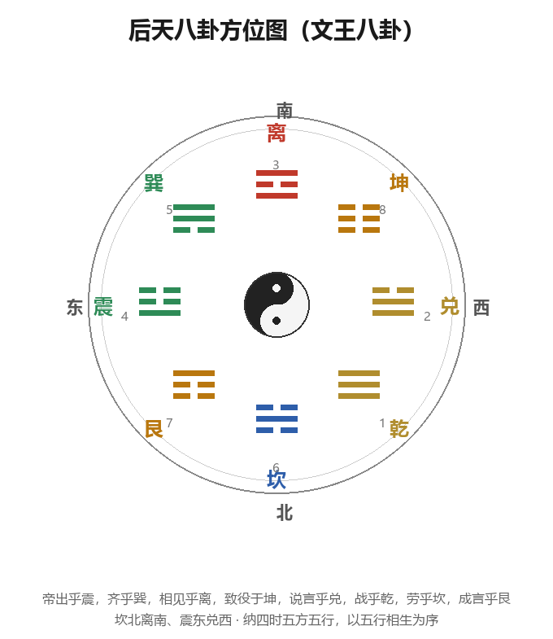
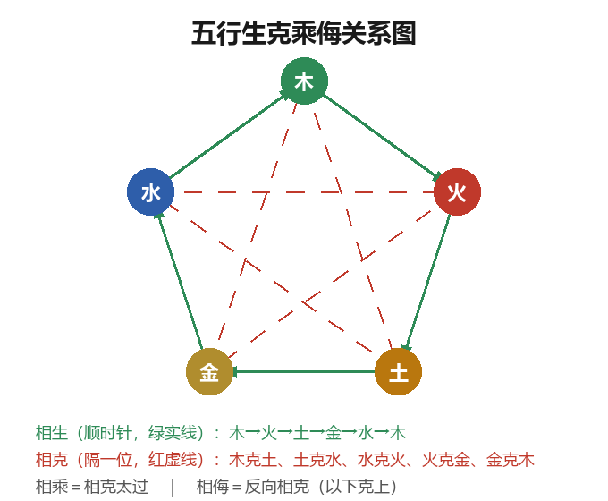
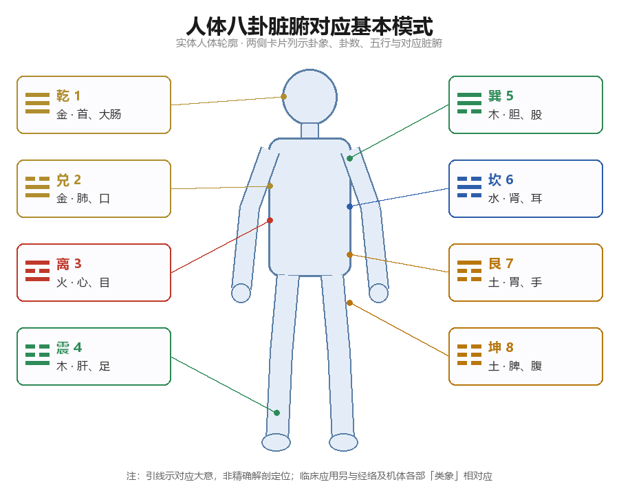
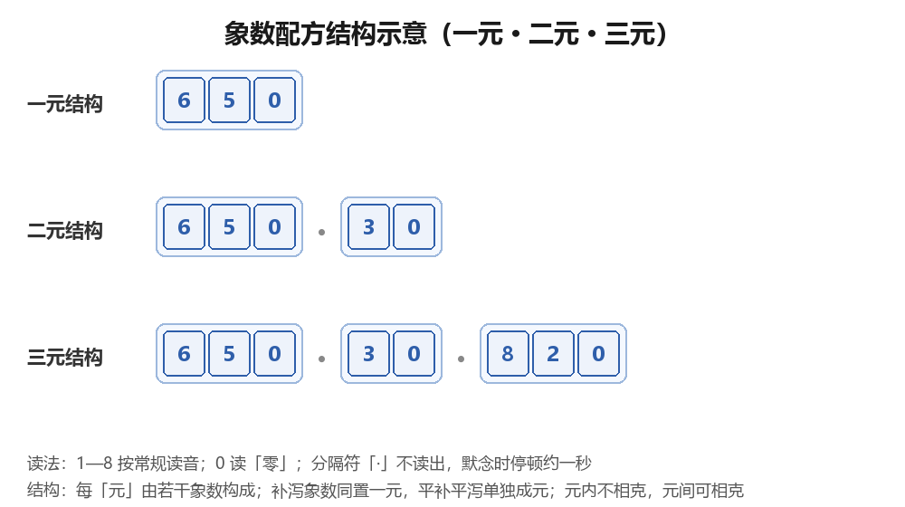

# 八卦象数疗法 · 研读笔记

## README · 导览

### README_1 研读对象与写法说明

本笔记研读两部著作：李山玉、李健民合著的《中国八卦象数疗法》（学苑出版社，1994）及其续编《八卦象数疗法再现神奇》（学苑出版社，1999）。2009 年团结出版社出版增订本《八卦象数疗法》，把两书正文与"比类取象，以类万物"章节整合为一册。

两书分工清晰：正编讲清基础学说与操作方法，续编转向内涵再界定、特点归纳、发展历程与实践报告。续编不是另起炉灶，而是正编的"证据卷"与"形象卷"。因此本笔记按主题重新归并，同一学说只在相应板块讲一次，续编的新增内容放进对应主题，避免重复。

| 阅读任务 | 直达板块 | 说明 |
| :--- | :--- | :--- |
| 了解成书、作者、版本 | 板块0 | 含两书与增订本的版本链 |
| 掌握四套基础学说 | 板块1～4 | 八卦、五行、阴阳、藏象，含卦数对应与人体八卦图 |
| 理解疗法内涵与特点 | 板块5 | 定义与本体层次、四大特点、理论体系、操作定位 |
| 学会辨证与配方 | 板块6 | 五种取数法、"0"的功能、默念流程 |
| 了解发展历程 | 板块7 | 1993—2004 大事记、龙口至青岛四次机构更迭 |
| 了解病例与报告 | 板块8 | 101 例归属说明、续编实践报告、再现神奇案例 |
| 判断证据与边界 | 板块9 | 证据分层、外部争议、适用边界、MLA 来源 |

### README_2 全书结构地图

主题阅读路径（节点编号与正文章节号一致）：

```text
[板块0 成书与流传]  正编 → 续编 → 增订本
        |
        v
[板块1～4 四套基础学说]  八卦 → 五行 → 阴阳 → 藏象
        |                    卦数/五行/脏腑三位一体
        |                    含 4_2 人体八卦对应：小宇宙与大宇宙同构
        v
[板块5 内涵与特点]  定义与本体层次 → 四大特点 → 理论体系 → 操作定位
        |
        v
[板块6 辨证与配方]  八纲为目、阴阳为纲 → 五法取数 → "0"调阴阳 → 默念反馈
        |
        v
[板块7 发展历程]  1993 创立 → 1994 正编 → 1995—1996 学术 → 1997—2001 机构推广
        |
        v
[板块8 病例与报告]  101 例归属 + 分组见证 + 病例类型 + 再现神奇
        |
        v
[板块9 证据评估]  体系自洽，但疗效证据等级偏低
```

### README_3 体例与术语门槛

- 序号一律使用「1」「2」「3」或"第1步"形式，不使用圆圈数字；章节层级为 `README_N`、`板块0`—`板块9` 与 `N_M`。
- 卦数取先天八卦数：乾 1、兑 2、离 3、震 4、巽 5、坎 6、艮 7、坤 8。象数配方中"·"为元气分隔符，默念时停顿约一秒；"0"读"零"，"1"读"yī"。
- 表格用于罗列对应关系与分类；流程图用等宽代码块重建；可量化的组合关系用数学块表达；示意图归档于 `images` 子文件夹，正文以相对路径引用。
- 事实层级用标签区分：[事实]指有公开来源支撑的出版、目录、通说信息；[推测/判断]指基于文本的评析；[不确定]指缺乏独立验证的疗效主张与个案。
- 引号内的表述为原书用语或公开资料原文；转述内容为本笔记作者的理解与重整，出处按 MLA 格式集中于板块 9_6。
- 本疗法属民间自然疗法范畴，其疗效主张缺乏对照试验支持。笔记忠实还原体系与案例，不把书中主张写成已证事实。

## 板块0 · 成书背景与流传

### 0_1 作者与成书

[事实] 李山玉（女，朝鲜族）为中医师、针灸医师，退休前任内蒙古赤峰学院校医，为世界医学气功学会会员、青岛山玉自然疗法研究所法人；1983 年开始研习《易经》。李健民为心理学副教授，在疗法创立中承担协助角色。据发展史大事记与出版资料，该疗法由李山玉于 1993 年 8 月、经十年临床探索与千百次自身试验总结而成；同年 10 月李山玉在世界医学气功学术交流会上被吸收为世界医学气功学会会员。2011 年李山玉另著《八卦象数点穴疗法》，2016 年与舒天合作发表论文《中医药新发展：象数疗法是一种特殊的自然疗法》。

[事实] 书名中的"八卦象数"由两层构成："八卦"指《周易》的八个单卦及其象义，"数"指与卦相配的先天数。作者把疗法定位为"易、医、气相结合的信息疗法"——易学提供象数模型，中医提供脏腑经络理论，气功提供默念的操作方式。

[推测/判断] 从成书背景看，本书属于 20 世纪 90 年代国内"医易研究"与"气功热潮"交叉语境下的产物。理解这一点有助于解释书中为何同时强调哲学阐释（易理）、临床叙述（病例）与体验性语言（"神奇""气冲病灶"）。

### 0_2 版本流传

[事实] 两书与增订本的版本链如下：

| 版本 | 出版时间 | 出版方 | 说明 |
| :--- | :--- | :--- | :--- |
| 《中国八卦象数疗法》初版 | 1994 年 9 月 | 学苑出版社 | 32 开，196 页，ISBN 9787507709100 |
| 《八卦象数疗法再现神奇》 | 1999 年 1 月（第 1 版） | 学苑出版社 | 续编，32 开，162 页，115 千字；ISBN 7-5077-1429-2；1999 年 5 月北京第 2 次印刷 |
| 《八卦象数疗法》（合编增订） | 2009 年 | 团结出版社 | 整合两书并增入内容；月份来源记载不一（百度百科作 5 月，360 百科作 4 月 1 日）；2022 年 5 月第 30 次印刷 |

[事实] 杨力为正编作序，序文落款 1994 年 4 月 10 日于中国中医研究院研究生部（北京）。据序文与研究所网站刊载的序文全文，杨力时任该部教授，是比利时国王颁发的"世界太极科学奖金"获得者，著有《周易与中医学》《中医疾病预测学》，序文对疗法持肯定态度，并以"一切科学皆来自于实践"为其合法性背书。续编代序摘录该序，其核心判断可归纳为四条：

| 判断 | 要点 | 序文要旨 |
| :--- | :--- | :--- |
| 体系定位 | 易象数指导、藏象基础、气功默念 | 以易象数原理为指导，以中医藏象理论为基础，结合气功默念，创造出八卦象数疗法 |
| 贡献评价 | 创造性贡献、医易学研究深入 | 为医疗学发展作出创造性贡献，反映医易学研究不断深入 |
| 知识论主张 | 实践优先、有效即可上升为理论 | 一切科学皆来自于实践，凡经得住实践考验、对人民行之有效者，皆可上升为理论、总结为科学 |
| 疗效依据 | 患者众多、疗效满意 | 经众多病人实践后疗效甚为满意，得到广大患者拥护 |

[事实] 序文还展望："二十一世纪必将是医易科学的世纪，医易科学必将以势不可挡的威力成为汇通中西医最强大的动力。"据出版方介绍，本书曾在日本、美国及中国香港地区发行。推广机构的演变（龙口、内蒙古、赤峰、青岛）见板块 7_2。

[推测/判断] 代序的论证核心是"实践优先"：先承认疗效，再反推理论合法性。其知识论主张在哲学上可讨论，但"有效"若要上升为"科学"，仍需可重复、可检验的证据，序文并未提供这一层论证。"发行至海外"与"成立研究所"属于出版方与机构的自述性推介，说明该书在民间传播较广，但不构成疗效的独立证明。

### 0_3 序文与"神奇"叙事

[事实] 序文之后，"神奇"一词贯穿两书。序文与前言的主线是：疗法虽"大道至简"，却在临床中产生令人意外的效果，作者据此主张"实践，是检验真理的唯一正确的标准"，凡经实践考验而有效者皆可上升为理论。续编前言用一组排比句为疗法定性，包括"千古之绝技，百姓之福音""易学之明珠，文化之瑰宝"，并强调"用事实证明自己的价值""不断续写一个又一个不可思议的、神话般的真实故事"。续编前言自述疗法由李山玉"经十年临床实践的艰苦探索"而成，落款"作者于 1998.8.18 子夜"；研究所网站后续自述"从问世至今，又经历了十多个春秋"。

[推测/判断] 这种"以疗效反推理论合法性"的论证方式，是两书共同的说服策略。它在逻辑上属于经验主义论证，说服力取决于疗效证据的质量；板块 9 专门评估这一问题。本笔记凡涉及疗效处一律标明为"书中记载"或"实践报告自述"。

## 板块1 · 八卦学说

### 1_1 学说基本内容与比类取象

[事实] 八卦学说是全书的第一套理论基础。书中把八卦理解为古人对宇宙万物基本性质与关系的分类模型：每一卦代表一类"象"，八卦合起来覆盖天、泽、火、雷、风、水、山、地等基本自然现象，并通过"比类取象"把万事万物归入这八类。

[事实] 八卦在疗法中只取八个单卦（三爻卦），不涉及六十四复卦。取象的核心方法是"比类取象"——把性质或形态相似的事物归入同一卦象，建立"象"与"数""脏腑""自然物"之间的对应网络。

[推测/判断] 这一步骤实质是建立分类索引：先确定某物属于哪一卦，再读出该卦的数字，完成从"物"到"数"的转码。后续所有配方操作都依赖这张索引表。

### 1_2 卦象与卦数

[事实] 八单卦的象义、先天数与五行归属是全书配方的基本对应表：

| 卦名 | 卦象（自然） | 先天数 | 五行 | 书中对应脏腑/部位 |
| :--- | :--- | :--- | :--- | :--- |
| 乾 | 天 | 1 | 金 | 首、大肠 |
| 兑 | 泽 | 2 | 金 | 肺、口 |
| 离 | 火 | 3 | 火 | 心、目 |
| 震 | 雷 | 4 | 木 | 肝、足 |
| 巽 | 风 | 5 | 木 | 胆、股 |
| 坎 | 水 | 6 | 水 | 肾、耳 |
| 艮 | 山 | 7 | 土 | 胃、手 |
| 坤 | 地 | 8 | 土 | 脾、腹 |

[事实] 先天数按"乾一、兑二、离三、震四、巽五、坎六、艮七、坤八"排列。书中明确取先天数而非后天数作为配方用数，理由是先天数反映宇宙结构与人体的对应关系；后天数用于解释五行流行与方位。

[推测/判断] 不同易学流派对卦象、五行、脏腑的对应存在多种说法，本书采用其中一种固定搭配。配方时若对应表取错，后续推演全盘皆错，这张表是全书的"语法底座"。

### 1_3 先后天八卦图与体用关系

[事实] 书中规定先后天八卦的关系是"先天为体、后天为用；以八卦为体、五行为用"。先天八卦描述宇宙的空间结构（"天地定位，山泽通气，雷风相搏，水火相射"），邵雍《大易吟》称之为"四象相交"，以阴阳学说为核心；后天八卦以"帝出乎震，齐乎巽，相见乎离，致役于坤，说言乎兑，战乎乾，劳乎坎，成言乎艮"为依据，描述运动变化，纳入四时五方五行，以五行学说为核心。



图 1-1　先天八卦方位图。本笔记据传统方位重绘；卦数与卦象对应依书中口径。



图 1-2　后天八卦方位图。本笔记据传统方位重绘；方位文字标注依通行读法。

先天数的排列可用数学块表示为一条固定映射：

$$
\varphi:\ \text{卦}\ \mapsto\ \text{先天数},\quad
\varphi(\text{乾,兑,离,震,巽,坎,艮,坤})=(1,2,3,4,5,6,7,8)
$$

[推测/判断] "体用"框架是本书处理两套图之间张力的办法：数从先天图取，五行生克按后天图推。读者若把两套图的方位混用，配方时会产生矛盾。续编"再论"的贡献正是把正编隐含的这层关系显性化。

### 1_4 "八卦"与"八卦象数"的再定义

[事实] 续编对"八卦"给出两层含义：一指《易经》的八个单卦，不涉及六十四复卦；二指先天八卦数与后天八卦图的统一。对"象"与"数"的关系，续编概括为"象以定数""数以征象"——象是数的具象，数是象的量化，二者同构，构成宇宙万事万物的征象与定数。

象与数的对应关系可用数学块表达为双射：

$$
\text{象}\ \overset{\text{定数}}{\longleftrightarrow}\ \text{数},\quad
\text{卦}_i \leftrightarrow i,\quad i=1,2,\ldots,8
$$

[推测/判断] "象数合一"是全书最核心的哲学预设：一旦接受数字可以承载"象"的信息，默念数字能影响人体就获得理论入口；若不接受这一预设，后续所有推导都失去前提。因此它是理解与评判本书的分水岭。

## 板块2 · 五行学说

### 2_1 基本内容：归类与生克乘侮

[事实] 八卦给出的是静态分类索引，五行则提供驱动这套索引运行的动态规则。五行学说把宇宙万物归为木、火、土、金、水五类，并以相生、相克、相乘、相侮描述其动态关系。书中列出事物属性的五行分类（五味、五色、五化、五气、五时等）与人体五脏、五腑、五体、五官、五华的对应。

相生与相克的次序可用数学块表示（"→"为相生，"⊣"为相克）：

$$
\text{相生}:\ \text{木}\to\text{火}\to\text{土}\to\text{金}\to\text{水}\to\text{木}
$$

$$
\text{相克}:\ \text{木}\dashv\text{土}\dashv\text{水}\dashv\text{火}\dashv\text{金}\dashv\text{木}
$$

[事实] 相乘指相克太过，超出正常制约；相侮指反向相克。书中据此说明五行关系既有常态的资生制约，也有病态的相乘相侮，配方时需辨别是哪一种状态。



图 2-1　五行生克乘侮关系。绿实线为顺时针相生，红虚线为隔位相克。本笔记绘制。

### 2_2 在中医学中的应用

[事实] 中医用五行学说说明四方面问题：

| 应用方向 | 具体内容 | 书中举例 |
| :--- | :--- | :--- |
| 说明生理 | 五脏分属五行，相互资生又相互制约 | 肝木、心火、脾土、肺金、肾水 |
| 说明病理 | 一脏病变影响他脏 | 肝病传脾（木乘土） |
| 用于诊断 | 由面色、声音、口味、脉象推断病位 | 面色青、喜酸、脉弦归肝木 |
| 用于治疗 | 依生克规律确立治法 | 培土生金、滋水涵木 |

### 2_3 在象数疗法中的应用

[事实] 疗法把五行生克当作取数与配方的直接规则：多数情况下配方内各象数保持相生关系，顺后天八卦的五行相生序排列；相邻两元之间有时出现相克关系，用以"泻有余"。同元之内的象数一般不相克。

[事实] 典型例子是配方 `650·30·820`，书中称其有温通肾阳、健脾益气之效，五行链条为：

$$
6_{\text{坎水}}\ \to\ 5_{\text{巽木}}\ \to\ 3_{\text{离火}}\ \to\ 8_{\text{坤土}}\ \to\ 2_{\text{兑金}}\ \to\ 6_{\text{坎水}}
$$

即水生木、木生火、火生土、土生金、金生水，构成首尾相接的相生闭环。另一例 `40·70` 用于胃实邪，4 震木克 7 艮土，属"元间相克"。

[推测/判断] 这套规则把中医的"治法"翻译为数字的"排列顺序"：相生序对应补益，相克关系对应攻泻。翻译是否成立属于体系内部约定，外部验证见板块 9。五行给出动态规则，而规则要分出补泻，还须先定阴阳——这是下一板块的任务。

## 板块3 · 阴阳学说

### 3_1 基本内容

[事实] 阴阳学说认为万物皆由相互对立又相互联系的两个方面构成。书中列出阴阳的三条基本关系：

| 关系 | 含义 | 书中表述 |
| :--- | :--- | :--- |
| 对立斗争 | 阴阳双方性质相反、相互制约 | 天地、刚柔、明暗 |
| 依存互根 | 一方以另一方为存在前提 | 无阴则阳无所附 |
| 消长转化 | 双方力量此消彼长并可相互转化 | 寒极生热、热极生寒 |

[事实] 书中引《易经》"一阴一阳之谓道"，把阴阳视为宇宙变化的根本法则，并据此确立全书最高原则——辨证施治以阴阳为纲。

### 3_2 在中医学中的应用

[事实] 中医用阴阳说明四方面：

「1」组织结构：上部、体表、背部、外侧属阳，下部、体内、腹部、内侧属阴；五脏属阴，六腑属阳。
「2」生理功能：健康状态是阴阳对立统一、协调平衡的结果。
「3」病理变化：疾病是阴阳失调的表现，如阴虚阳亢、阳虚阴盛。
「4」诊断治疗：诊断以阴阳为总纲，中医有"善诊者，察色按脉，先别阴阳"之说；治疗以调整阴阳、补不足损有余为目标，如滋阴潜阳。

### 3_3 阴阳为纲：辨证的总开关

[事实] 作者反复强调：临床证候千变万化，但可归纳为阴阳、表里、寒热、虚实八类（"八纲"），其中阴阳是总纲。配方前必须先判明阴阳盛衰，否则"象数配方再好亦无济于事，甚者还会引起反效应"。

[事实] 书中给出一组对照配方说明阴阳辨析的后果：

| 证型 | 配方 | 方义（书中说法） | "0"的位置 |
| :--- | :--- | :--- | :--- |
| 风寒表证 | `80·50·60` | 8 温振脾胃驱寒、5 温阳疏风、6 疏膀胱经解表 | 0 在数后，偏阳助通脉 |
| 风热表证 | `04·06·07` | 4 疏肝散热、6 祛表邪、7 扶正驱邪 | 0 在数前，偏阴祛热邪 |

[事实] 两方另有随症加减：咳嗽时加 `20` 或 `02` 以宣肺。

[推测/判断] 这两方的对照最能体现"同病异治、随阴阳加减"的思路：病位都在表，但因寒热属性不同，配方中"0"的位置随之翻转。这是理解 6_4"0 的功能"的钥匙。

## 板块4 · 藏象学说与八卦对应

### 4_1 藏象学说综述

[事实] 藏象学说是中医关于脏腑生理、病理及其相互关系的理论体系，书中把它作为八卦象数疗法的中医基础，用于把卦象、数字与具体脏腑挂钩。书中分五脏（心、肺、脾、肝、肾）、六腑（胆、胃、小肠、大肠、膀胱、三焦）论述，另附脑与女子胞。

[事实] 作者指出，藏象经络理论是"比类取象"取数配方的基本思路：人体及每个脏腑、器官乃至细胞都被视为布列着八卦全息结构，与宇宙八卦相通，因而可以"近取诸身，远取诸物"，灵活取象。

### 4_2 人体八卦对应基本模式

[事实] 书中给出的人体八卦对应基本模式如下：

| 卦 | 数 | 五行 | 对应脏腑/部位 | 典型取象用途（书中举例） |
| :--- | :--- | :--- | :--- | :--- |
| 乾 | 1 | 金 | 首、大肠 | 头部、督脉相关 |
| 兑 | 2 | 金 | 肺、口 | 皮肤病取 2（肺主皮毛） |
| 离 | 3 | 火 | 心、目 | 目疾、急性结膜炎取 3 |
| 震 | 4 | 木 | 肝、足 | 足疾取 4（震对应足） |
| 巽 | 5 | 木 | 胆、股 | 与 6 配伍调气血 |
| 坎 | 6 | 水 | 肾、耳 | 补肾阳取 6 |
| 艮 | 7 | 土 | 胃、手 | 鼻疾取 7（胃经夹鼻上行） |
| 坤 | 8 | 土 | 脾、腹 | 健脾取 8 |



图 4-1　人体八卦脏腑对应基本模式。本笔记据书中对应表绘制：人体取实体轮廓，两侧卡片列卦象、卦数、五行与对应脏腑，引线示对应大意而非精确解剖定位。

[事实] 书中强调这只是基本模式，实践中八卦还与经络及机体各部的"类象"相对应，以体现天人合一、天人相应、人体八卦与宇宙八卦的统一。

[推测/判断] 有限的基本模式加上无限的类象延伸，是本书保持灵活性的关键设计：它使体系能容纳新案例，但也使边界变得模糊。

### 4_3 五脏的生理病理与象数

[事实] 书中按中医藏象通说分述五脏，并把每脏与相应卦数捆绑：

| 五脏 | 卦数 | 书中强调的生理病理要点 | 常见配伍数（书中举例） |
| :--- | :--- | :--- | :--- |
| 心 | 离 3 | 主血脉、藏神；汗为心之液；心火偏亢则烦、目赤 | 3 配 6 交通心肾；3 配 8 安神 |
| 肺 | 兑 2 | 主气、司呼吸、主皮毛；肺气虚则咳喘、鼻塞 | 2 配 6 补肺滋阴 |
| 脾 | 坤 8 | 主运化、主肌肉四肢；脾虚则倦怠、腹泻、水肿 | 8 配 20、650 健脾 |
| 肝 | 震 4 | 主疏泄、藏血、开窍于目；肝郁则情志不舒，肝阳上亢则头晕 | 4 配 0 疏肝，4 配 7 抑木扶土 |
| 肾 | 坎 6 | 藏精、主水、开窍于耳；肾阳虚则腰膝冷痛、小便不利 | 6 配 5 滋补肾阴，6 配 8 温阳健脾 |

[推测/判断] 书中的阐述方式是"中医理论＋象数配伍"双层叠加：先用中医语言描述病机，再把治法映射为数字组合。读者需熟悉中医基础术语才能读懂方义解释。

### 4_4 六腑与附论

[事实] 六腑与卦数的对应及书中要点：

| 六腑 | 卦数 | 书中要点 |
| :--- | :--- | :--- |
| 胆 | 巽 5 | 与肝相表里，主决断，蓄藏胆汁 |
| 胃 | 艮 7 | 主受纳腐熟；胃气以降为顺；阳明胃经夹鼻上行（鼻疾取 7 的经络依据） |
| 小肠 | 离 3（与心同） | 主受盛化物、泌别清浊，与心相表里 |
| 大肠 | 乾 1 | 主传导排泄，与肺相表里 |
| 膀胱 | 坎 6（与肾同） | 贮尿排尿，与肾相表里；解表常取 6 以疏膀胱经 |
| 三焦 | — | 通行元气、运行水液，多在上焦热证中论及 |

[事实] 附论专列"脑"与"女子胞"：脑归入乾（首）范畴，与神志活动相关；女子胞与胎位、月经等妇科问题相关，续编有"胎位不正及脐带缠颈"等案例。

[推测/判断] 六腑的卦数对应不如五脏整齐（小肠、膀胱与心、肾共用卦数），这提示对应表是实用性的近似归并；实际配方中，经络循行取数法（6_3）弥补了脏腑对应的不足。四套学说至此备齐，下面转入疗法自身的定义、特点与体系定位。

## 板块5 · 疗法内涵、特点与理论体系

### 5_1 疗法定义与本体层次

[事实] 四套学说讲清"用什么讲理"，本板块转入"疗法本身是什么"。两书对疗法的简短定义是：通过默念一组象数达到治病健身目的的易医气功疗法；以天人合一思想为指导，以易学阴阳五行八卦象数学说为核心，以中医藏象理论为基础，以气功默念为基本方式，使易、医、气有机结合。

[事实] 书中对作用机理的说明是：默念象数形成次声波，调动人体自我调节功能，疏通经络、调和气血、趋向阴阳平衡；这一解释与"信息波""场谐振"说法一起，构成书中的机理层叙述，均属体系内部解释而非可测量的机制证明。

[事实] 作者从本体论把疗法分为两个层次，续编进一步补入诊断层次：

| 层次 | 内容 | 在体系中的角色 |
| :--- | :--- | :--- |
| 理论层次 | 易学哲学（阴阳、八卦、五行）为核心，中医藏象经络为基础，气功心理学场效应为机理 | 提供解释框架 |
| 操作层次 | 默念象数作为信息载体，促成宇宙场与人体场和谐共振 | 提供干预手段 |
| 诊断层次 | 象数配方辨证施治，"一把钥匙开一把锁" | 提供个体化规则 |

### 5_2 四大特点

[事实] 续编用四个词概括疗法特点：

| 特点 | 核心主张 | 支撑理由（书中说法） |
| :--- | :--- | :--- |
| 大道至简 | 操作简便，无需器械药物场地 | 只需默念一组数字，可快速上手 |
| 返朴归真 | 回归自然，不借助外力 | 心态形态顺其自然，不限时地方位 |
| 功力非凡 | 默念可产生强大调节作用 | 配方与机体结合成八卦场，与宇宙场谐振 |
| 疗效奇特 | 临床产生意外效果 | 由大量"不可思议"的案例支撑 |

[事实] "返朴归真"的具体要求可用三个特点概括，也是默念操作的基本风格：

| 特点 | 含义 | 具体要求 |
| :--- | :--- | :--- |
| 自然 | 无规定的外部动作 | 心态与形态顺其自然 |
| 自由 | 不拘条件 | 不限时间、地点、条件、方位 |
| 自为 | 不依赖外援 | 不需外气诱导，不需音乐 |

[事实] 续编举"各取所需"的例子说明功力：足疾者与肝疾者都可念 `40`，因震卦 4 对应足与肝，机体凭自调能力各自摄取所需信息、直达病所。场谐振关系可形式化表达为：

$$
\text{人体场}\ \xrightarrow{\text{默念象数}}\ \text{同步谐振}\ \xrightarrow{\text{自调}}\ \text{阴阳平衡}
$$

[推测/判断] "简便性"既是优点也是风险：门槛低但容易让人忽略辨证这一真正难点。"场""共振""信息"是借用的物理学词汇，书中未给出可测量定义，起的是类比解释作用。"奇特"本身是叙事选择的结果——编者挑选最戏剧性的案例入书，按结果取样，不能由此推断一般成功率。

### 5_3 理论体系：指导思想、基本理论与配方原则

[事实] 四大特点描述疗法"呈现为什么样"，理论体系则回答"由什么支撑"。续编把指导思想、基本理论与配方原则分层表述：

「1」指导思想：天人合一整体观。天体是大宇宙，人体是小宇宙，同为八卦结构，天人相应。
「2」基本理论：易学阴阳五行八卦象数学说为核心，中医藏象经络为基础，气功默念为操作。
「3」配方原则：辨证为先、补泻有法、结构分层、法无定法，根本规律是"法于阴阳"。研究所网站把作者的配方要领概括为一句口诀："八卦为体，五行为用，比类取象，以类万物，以象定数，辨证施治，平衡阴阳，效于气场"；治疗要领另引"正气内存，邪不可干，阴平阳秘，精神乃治"。

[推测/判断] 天人合一作为哲学立场自洽，作为疗效机制则需要额外经验证据，书中未提供。四原则中"法无定法"是体系的安全阀：当配方结果与预期不符时，它可解释个体差异，使体系不被个案反驳，但这也带来不可证伪性。

### 5_4 操作定位：自我调节与责任转移

[事实] 承 5_2"返朴归真"所述"自然、自由、自为"三特点，作者特别指出，本疗法不同于传统气功：它是易经、中医和气功的融合。这三个特点把疗法定位为"自我调节"技术，与需要施术者的气功、推拿区分开来。

[推测/判断] 这一定位降低了对操作者资质的依赖，也把责任转移到学习者自身的辨证能力上——门槛降低的同时，正确使用的难度反而提高。这一张力在 6_3"法无定法"处进一步放大。

## 板块6 · 临床应用：辨证与配方

### 6_1 辨证施治：八纲与母子补泻

[事实] 前四个板块解决"用什么讲理"，本板块解决"怎么用在临床"。辨证施治以阴阳五行学说为纲、八纲辨证为基础，把疾病归入阴阳、表里、寒热、虚实八类，阴阳为总纲。治则上主张"虚则补之，实则泻之""平补平泻"，并概括为"母子补泻法"：

| 补泻类型 | 判定规则 | 含义 |
| :--- | :--- | :--- |
| 补 | 母生我 | 资生本脏的象数用于补虚 |
| 泻 | 我生子 | 本脏所生之子的象数用于泻实 |
| 平补平泻 | 介于虚实之间 | 双向调节，单独成元 |

[事实] 书中还强调"标本缓急""标本兼顾""同病异治""异病同治"，要求依病情变化调整配方，反对把书中配方当作固定套路照搬。

### 6_2 配方的读法与结构

[事实] 读法规则：1—8 按普通话正常读音，"1"须读"yī"不读"yāo"；"0"读"líng"不读"dòng"；"·"不读出，默念时停顿约一秒。配方有一元、二元、三元结构，`650` 为一元、`650·30` 为二元、`650·30·820` 为三元。



图 6-1　象数配方的元结构。本笔记绘制；"·"为元气分隔符。

配方的形式化表达（"元"为分隔符切分出的单元）：

$$
\text{配方} = \text{M}_1 \cdot \text{M}_2 \cdots \text{M}_k,\quad
\text{M}_i = d_{i1}d_{i2}\cdots d_{in},\ d_{ij}\in\{0,1,2,3,4,5,6,7,8\}
$$

[事实] 各元组合遵循母子补泻法：补泻象数同置一元，平补平泻单独成元，元间以圆点隔开。这一结构规则如何生成具体配方，由 6_3 的五种取数法回答。

### 6_3 五种取数配方方法

[事实] 两书共同列出五种基本取数方法，这是操作部分的核心：

| 方法 | 取数依据 | 书中示例 | 方义（书中说法） |
| :--- | :--- | :--- | :--- |
| 「1」按八卦之象 | 病位与卦象对应 | 足疾取 4，前后加 0 成 `0004000` | 震对应足，加 0 通经气、利水消肿 |
| 「2」按藏象理论 | 脏腑与卦象对应 | 皮肤病取 2，加 0 成 `0002` | 兑主肺，肺主皮毛，疏风利湿 |
| 「3」按君臣佐使 | 象数如中药配伍 | 肝阳上亢头晕取 `640·30·80` | 6 为君滋肾阴、4 为臣补肝阴（六四相合滋阴潜阳），8 为君健脾升清降浊，3 为佐除烦安神 |
| 「4」按经络循行 | 经脉所过 | 鼻疾取 7，配 `07` | 艮主胃属阳明胃经，胃经夹鼻上行 |
| 「5」按五行生克 | 相生相克序 | `650·30·820`；胃实邪 `40·70` | 前者顺相生，后者木克土 |

[事实] 第「3」法"君臣佐使"借自中药方剂学，其角色分工如下：

| 角色 | 中医定义 | 象数配方中的对应 |
| :--- | :--- | :--- |
| 君 | 针对主证起主要作用 | 针对主要病机的核心象数 |
| 臣 | 协同加强君药功效 | 加强核心象数作用的象数 |
| 佐 | 协助君药，或治次要症状 | 辅助或兼顾兼证 |
| 使 | 引经，或调和诸药 | 引导或调和全方 |

[事实] 作者明确反对把这五法固化成"一方治一病"的查表法，反复引用《系辞》"变动不居，周流六虚""不可为典要"，主张"配方有法"而"法无定法"，根本规律是"法于阴阳"。

[推测/判断] 这一弹性原则是体系的自我保护机制：规则只能作入门框架，难以形成可标准化、可重复验证的操作手册。

### 6_4 "0"的功能与运用

[事实] "0"承担强化信息波能量、通经气、调阴阳的作用，作者称其为配方中不可缺少的环节，并以太极元气浑然之象作比。其阴阳属性判定规则可形式化为：

$$
\text{「0」属性}=
\begin{cases}
\text{偏温阳} & \text{并列个数为奇数}\\
\text{偏滋阴} & \text{并列个数为偶数}\\
\text{偏阴} & \text{位于象数之前}\\
\text{偏阳} & \text{位于象数之后}
\end{cases}
$$

[事实] 书中给出临界案例：肺阴虚咽干咳嗽通常配 `002`（双 0 偏阴），但阴阳俱虚者念 `002` 反而助阳，出现"阴极生阳"；`00200` 整体偏阴而含阴中生阳之效，`0002000` 整体偏阳而含阳中生阴之效。作者据此强调"0"的用法须依个体阴阳盛衰灵活掌握。

[推测/判断] "0"的规则是全书中最精细也最依赖经验判断的部分：同一规则在不同体质上给出相反结果，作者以"机体差异"解释，提高了体系的解释弹性，但降低了可预测性。

### 6_5 默念操作与反馈流程

[事实] 推荐放松入静，睡前与醒后效果更佳，时长顺其自然。完整操作流程如下：

```text
[第1步 辨证]  八纲定位 → 判明阴阳虚实
     |
     v
[第2步 取数]  五法择一或合用 → 生成候选象数方
     |
     v
[第3步 试念]  短时默念，观察感应（头清目明等）
     |           短则数秒至数分钟，长则十余至数十分钟
     |           无明显感应者坚持默念亦有效
     |
     +--> 头/胃/心不适 --> [回退第2步] 重调配方
     |
     v （无不适）
[第4步 持念]  自然、自由、自为；时长顺其自然
     |
     +--> 患处症状暂加重且头胃心无不适 --> 视为"气冲病灶"，继续
     |
     v
[第5步 反馈]  病愈后继续默念以巩固；依病情变化调整配方
```

[事实] 注意事项：精神不正常或记忆力极差者禁用；可单独施用，也可与针刺等疗法配合；出现类似"晕针"反应按晕针处理。

[不确定] 论坛与普及资料另流传若干书中规范之外的用法：把象数写在胶布上贴于丹田、由他人握住患者手代念、默念时远离电器、夫妻不同床念等。这些做法见于含象堂论坛、国粹网等转载，两书正文未见同等表述，是否为原书所载待核，本笔记不作为书中规范列出。

[推测/判断] "气冲病灶"把治疗中的不适重新定义为"好转反应"，属于无法证伪的安排——任何反应都可被纳入体系内部解释。读者遇到持续不适应以规范医学检查为先。

## 板块7 · 发展历程

### 7_1 探索与问世（1993—1994）

[事实] 据公开的发展史大事记，疗法由李山玉在长期临床实践中探索而成，李健民以心理学专业背景协助。关键节点：1993 年 8 月疗法创立，首篇论文《八卦象数疗法》发表于《中华气功》第 4 期；同年 10 月李山玉参加第二届世界医学气功学术交流会；1994 年 9 月正编由学苑出版社出版，杨力作序。探索过程被书中自述为"十年临床实践的艰苦探索"与"千百次自身试验"。

### 7_2 学术发表与机构推广（1995—2004）

[事实] 发展史大事记列出以下节点：

| 时间 | 事件 |
| :--- | :--- |
| 1995 年 3 月 | 南京首届国际易医学术研讨会，论文《八卦象数疗法的临床研究》获优秀论文，收入《易医文化与应用》 |
| 1996 年 8 月 | 郑州国际中医与周易学术研讨会，宣讲论文《关于八卦象数疗法疑难问题的临床研究》 |
| 1997 年 2 月 18 日 | 经山东龙口市政府主管部门批准成立"龙口中国八卦象数疗法研究所"，李山玉任所长；同年 4 月举办普及函授班 |
| 1997 年 2 月 | 该所开始编印内部资料《易医文化》（双月刊） |
| 1998 年 8 月 | 经内蒙社会心理学会批准，在赤峰成立"内蒙古社会心理学会易医文化心理专业委员会"，李健民任主任 |
| 1998 年 12 月 30 日 | 龙口研究所注销，业务移交内蒙古专委会，推广基地回到赤峰 |
| 1999 年 1 月 | 续编《八卦象数疗法再现神奇》出版 |
| 1999 年 2 月 15 日 | 赤峰李山玉易医科技研究所经赤峰市科委审批成立，3 月 18 日注册 |
| 1999 年 5 月 | 赤峰研究所与《中国气功科学》杂志联合举办函授班 |
| 1999 年 12 月 3 日 | 中国医疗保健国际交流促进会自然医学研究会象数疗法推广中心在赤峰成立，李山玉任主任 |
| 2001 年 10 月 | 青岛山玉自然疗法研究所成立，李山玉任所长，面向国内外招收函授学员并举办面授班 |

[事实] 续编前言写于 1998 年 8 月，当时自述成立的是"龙口中国八卦象数疗法研究所"并举办函授班；这与 2001 年成立的"青岛山玉自然疗法研究所"是两个不同时期、不同地点的机构。大事记显示，两者之间还有内蒙古专委会与赤峰研究所两个阶段。

完整时间线可表示为：

$$
1993\ \text{创立}\to1994\ \text{正编}\to1995\text{—}1996\ \text{学术发表}\to1997\ \text{龙口所}\to1998\ \text{赤峰专委会}\to1999\ \text{赤峰所/续编}\to2001\ \text{青岛所}
$$

```text
[第1步 探索]  临床实践 + 自身试验 → 形成配方雏形（1993）
     |
     v
[第2步 问世]  正编出版 + 名家作序 → 建立文本权威（1994）
     |
     v
[第3步 学术]  论文发表 + 获奖 → 进入学术会议（1995—1996）
     |
     v
[第4步 组织]  龙口所 → 内蒙古专委会 → 赤峰所 → 青岛所
     |           函授 + 面授 + 内部刊物 → 扩大传播
     v
[第5步 影响]  社会影响力上升，但证据质量未同步提升
```

[推测/判断] 这条时间线呈现的是"个人经验—文本化—学术化—组织化"的传播路径。每一步都增强了社会影响力与组织化程度；但影响力增长与疗效证据质量提升是两回事。机构多次更迭与迁移，也提示其推广长期依赖个人与地方资源，而非稳定的学术建制。组织化的成果之一，是积累了大量病例与实践报告——这正是下一板块的材料来源。

## 板块8 · 临床资料与实践报告

### 8_1 "101 例"的归属与性质

[事实] "典型病例 101 例"见于正编与增订本的第六章目录。另一方面，发展史大事记明确记载：1999 年续编《八卦象数疗法再现神奇》"选取部分函授学员的 101 个典型病例"。搜狗百科亦称增订本"列举了 101 个典型病例，并且每个病例后面均有方义和患者自述"。两处"101 例"的归属存在交叉，本笔记并列呈现，不替原书判定是否为同一批病例。

[推测/判断] 病例承担"以例证理"的功能：用个案数量营造经验的广度，用戏剧性结果强化"神奇"印象。读者宜把它们当作叙述材料，而非疗效统计。

### 8_2 续编实践报告的分组

[事实] 续编第五部分设"关于《来自国内外的实践报告》的说明"，第六部分汇集报告，案例由各地读者与实践者提供，按报告人分组编排。设置专门说明，表明编者意识到案例材料需要交代来源；但说明的重点是"谁报告"，而非"如何验证"，材料性质仍属自述见证。原书目录列出的报告人远不止六位，按序号至少编至"三十七"组；前六位报告人与条目如下（页码为原书标注）：

| 报告人 | 主要条目 | 原书页码 |
| :--- | :--- | :--- |
| 李庆平 | 治疗肝癌疼痛、胃癌疼痛（两则） | 44—46 |
| 张日清 | 切脉时机治胃病、十三年的鼻道炎、胆结石疗效神奇 | 46—49 |
| 姜立业 | 怪病四肢瘫软、二年的胆囊炎 | 49—50 |
| 蒋天恩 | 双目重见光明、腰间盘脱出、默念奇异现象、癫痫、医生老伴肺结核、近三十年哮喘 | 50—57 |
| 夏金庭 | 十七年的肩周炎、双脚溃烂、腰伤、胃窦炎 | 58—60 |
| 金英钧 | 腿痛立竿见影、双耳恢复听力、卧床二月的司机又开车、象数疗法能戒酒 | 61—64 |

[事实] 目录后续还列有汪开源、相明悦、王一均、韦惠兰、凌野、朱山怀、童清华、庚灵子、张福臣、曹晓梅、赵长阳、郑祖桂、陈能、孙立友、王永友、曹成华、解小华、张棋年、刘改仙、赵显荣、沈咏馨、吴克柄、武希木、周泽选、张柏荣、王爱莲、查一棠、倪汝华、韩传英、凌树章、赵保和等报告人，条目数由 1 则至 8 则不等。

[事实] 条目命名采用"治疗＋病种＋结果修饰"的句式，如"治疗十三年的鼻道炎""腿痛立竿见影"。病程长度与结果的戏剧性是命名的两大要素。

### 8_3 病例选析

[事实] 两书病例覆盖内外妇儿等科，以下按方义类型选录若干，用以说明配方思路（均为书中记载）：

| 病症（书中表述） | 象数方 | 书中给出的取数思路 |
| :--- | :--- | :--- |
| 气管炎（七八年） | `020·160` | 2 补肺气，1 通大肠、6 补肾，标本兼顾 |
| 偏瘫 | 多据辨证配 `650·430·820` 类 | 补肾、疏肝、健脾合用，多配有复健过程叙述 |
| 冠心病 | `650·430·820` | 温通肾阳、疏肝、健脾，属五行相生链 |
| 心绞痛、心悸 | `650·4300·70` | 在温阳基础上加 70 调和 |
| 急性结膜炎 | `003` | 3 离主目，双 0 偏凉，取"水克火"泻火之意 |
| 鼻炎前额痛 | `07` | 艮 7 循阳明胃经取数 |
| 小儿腹泻 | `80·20` 贴脐 | 坤 8 健脾、兑 2 理肺气，外敷用法 |
| 糖尿病足溃烂 | 书中随证加减，举 `650·380` 类为例 | 温阳与健脾并进；同病异治，非固定方 |

[推测/判断] 这些配方与 6_3 的五法一一对应，病例部分主要是操作规则的实例化。同一病种在不同个案中配方并不相同，印证了"同病异治"的主张，但也使"方—病"难以形成固定对照。

### 8_4 比类取象与"再现神奇"案例群

[事实] "比类取象，以类万物"把八卦取象从人体扩展到万物：八卦是宇宙结构的普遍模式，人体是小宇宙，万物与人体同构，凡属性或形态可归入某卦者皆可取该卦之数。书中举例：机体中"凸"的部位视为艮象而取 7；形体、方位、颜色、声音等属性皆可"以类相从"。延伸应用体现在三方面：

| 应用面 | 取象方式 | 书中线索 |
| :--- | :--- | :--- |
| 自然物 | 把万物归入八类之象 | "远取诸物"，如植物八卦场实验 |
| 环境 | 把场、方位纳入八卦 | "世界万物都有场"，注意环境场干扰 |
| 心理情志 | 把情志归于脏腑 | 用象数 4 调治情志失调（肝主疏泄） |

[事实] 续编与增订本"八卦象数疗法再现神奇"（一）组收录的代表案例标题包括：女婴先天性血瘤消失、治疗高位截瘫有奇效、孕妇胎儿扶正后顺利降生、治疗扭伤和止血效果令人惊奇、排除体内 9.5 cm 长的金属螺丝、一位肺癌患者绝处逢生、老人双目重见光明、治疗双脚溃烂、韩国修女东叶的奇迹轰动汉城。

[事实] "再现神奇"（二）组以"复刊致辞"开篇，随后是一批把象数与中药性味、藏象理论类比的案例标题，完整清单如下：治愈牛皮癣、肝主情志、肝开窍于目与肝受血而能视、汗为心之液、治疗胆总管结石、脾开窍于口、八卦象数降血糖效果不错、避免换膝手术、白内障飞蚊症速效、伤筋动骨十天愈、座椅贴象数减病痛、八龄儿童自调配方治腮肿、三十多年头疼不药而愈、大胆配数获奇效、偏瘫恢复快无后遗症、万物均有八卦场（植物实验）、治牙显奇效、糖尿病烂足、便血五年、左心室肥大不药而愈、胎位不正及脐带缠颈、双膝关节退行性病变、胰头癌、战癌症闯难关、胫骨粉碎性断裂复位、腰痛消失、紫斑不复发、用象数 4 调治情志失调、三十年结肠炎、饥饿症、神经分裂症、小学生腹痛、下肢浮肿与信息叠加。其中多条标题直接引用中医理论命题（如"肝主情志""汗为心之液""脾开窍于口"），体现"以医理释方义"的写法。

[推测/判断] "以类万物"把体系开放为无限联想空间，任何新事物都能被归入八卦之一，增强了解释力与传播力，也使其难以被限定和检验。案例的叙事策略是"极端个案＋见证人署名＋地方细节"，以增强可信度；但个案的戏剧性与证据强度成反比。

### 8_5 病例类型、叙事策略与证据说明

[推测/判断] 按病种性质，报告条目可归纳为四类，其证据敏感性依次升高：

| 类型 | 举例 | 说明 |
| :--- | :--- | :--- |
| 症状性常见病 | 胃病、鼻炎、肩周炎、腰伤 | 病程与缓解可能受多种因素影响 |
| 功能性问题 | 失眠、戒酒、情志失调 | 安慰剂效应与生活方式改变难以排除 |
| 感觉器官问题 | 双目重见光明、双耳恢复听力 | 需客观检查佐证，书中未见 |
| 重症与器质病变 | 肝癌、胃癌、肺癌、胆结石、截瘫 | 最需严格验证，也最不应替代规范治疗 |

[推测/判断] 综合两书案例，叙事策略可归纳为三点：

| 策略 | 表现 | 对读者的影响 |
| :--- | :--- | :--- |
| 极端取样 | 只收录反转强烈的案例 | 高估一般疗效 |
| 见证署名 | 标注报告人姓名、身份、地点 | 增强可信感，但不等于验证 |
| 理论回扣 | 用中医命题解释方义 | 让结果显得"有道理"，混淆解释与证明 |

[事实] 作者在论文中提到，许多读者试图把配方按病种归类寻找固定模式，作者认为这"有悖于《易》的变易原则"，因为"同类象本身所含的信息是无限的，疾病的变化是复杂的，人的机体是有差异的"。

[推测/判断] 正确读法是把案例当作"作者的论证材料"而非"疗效数据库"：关注其如何讲述，而非其宣称的结果。对涉及重症的案例，读者尤应保持判断力。

[不确定] 两书病例所述疗效均为作者与读者的自述记录，未见对照、盲法或长期随访数据；个案同时接受的其他治疗、自愈与安慰剂效应均未被排除，不能据此认定疗效的真实性或归因于象数本身。

## 板块9 · 研读结论与证据评估

[事实] 材料层面的梳理至此完成。最后转入评估：先检验体系内部是否自洽，再以外部证据标准衡量其疗效主张，并给出阅读边界。

### 9_1 体系自洽性

[推测/判断] 就内部逻辑而言，两书体系是自洽的：八卦提供分类，五行提供动态规则，阴阳提供总纲，藏象提供人体接口，"0"提供精细调节，比类取象提供向外延伸通道，六个环节衔接成闭环叙事。

[推测/判断] 体系强项在于结构完整、操作简单、记忆成本低；弱项在于核心概念（"信息波""八卦场""次声波共振"）多为类比性描述，缺乏可测量定义，难以在体系外部被检验。

### 9_2 两书的增量关系

[推测/判断] 续编相对正编的增量集中在三处：

「1」概念清晰化：把"八卦""八卦象数"分层定义，把先后天体用关系显性化。
「2」特点体系化：用"大道至简、返朴归真、功力非凡、疗效奇特"四词概括疗法形象。
「3」案例规模化：以分组实践报告与"再现神奇"系列，把正编零散病例扩展为系统叙事。

[推测/判断] 理论层面增量有限，主要沿用正编框架；续编真正的新增价值在材料层面与形象建构层面。

### 9_3 疗效证据分层

[事实／不确定] 按证据等级对两书内容分层：

| 层级 | 证据类型 | 两书中的对应 | 证据强度 |
| :--- | :--- | :--- | :--- |
| 高 | 随机对照试验、系统评价 | 未见 | 无 |
| 中 | 队列研究、病例对照 | 未见 | 无 |
| 低 | 病例系列、无对照观察 | "101 例"病例集 | 弱 |
| 极低 | 个案报告、个人见证 | "再现神奇"诸例、读者实践报告 | 极弱 |
| 非证据 | 理论阐释、哲学论证 | 序文、易理推导 | 不构成疗效证据 |

[推测/判断] 两书的疗效论证主要停留在"极低"与"非证据"两层，以个案数量与叙事强度代替证据质量。这决定了它在医学共同体中难以获得认可。争议焦点有三：象能承载信息的哲学预设能否被经验支持；个案叙事能否作为疗效依据；"法无定法"的弹性是否使体系不可证伪。本笔记对三者均不作定论，只呈现结构与问题。

[不确定] "默念象数可治病健身"这一核心命题，目前缺乏可公开验证的高质量证据支持；本笔记无法对其真伪作出判定。

### 9_4 外部公开评价与争议

[事实] 公开资料中并存着与书中自述相对的批评声音。据 360 百科"科学质疑"段转引的媒体报道（原报道链接已失效）：南京市明基医院副主任医师胡建华在了解该疗法原理后，判断其为"伪科学"，理由是通过八卦图与数字串作诊断、定疗效缺乏科学依据，疗效须经随机、对照、可重复三原则检验；青岛市卫生局医政处、科技局法规处工作人员均表示，未查到"青岛山玉自然疗法研究所"的备案登记或技术审批记录。

[事实] 将上述质疑与 0_2 的序文及出版方自述对读，可见争议集中在两点：一是疗效主张是否满足科学验证标准，二是推广机构的登记资质。前者属证据标准问题，后者属机构合规问题，二者相互独立，不能互相替代论证。

[不确定] 研究所网站另有自述："仅 1991—1993 年对 1860 名患者的临床观察，其有效率在 90.8% 以上。"该站同页亦坦承："很显然，这是李山玉大夫关于八卦象数疗法的机理的假说或猜想。假说和猜想，虽然可以成为科学的先导，但毕竟需要论证和实践的检验。"这一有效率数字未见原始病例表、观察方案或对照设计，本笔记按[不确定]处理，不作为 9_3 证据分层中的中级证据。

[推测/判断] 批评者所依据的"随机、对照、可重复"标准，与 9_3 的证据分层结论方向一致：两书案例确实停留在个案与见证层级。因此外部质疑并非提供反证，而是指出书中证据尚未达到的最低门槛。另一方面，"研究所未查到备案"只是资质状态的报道，不足以单独判定疗法内容真伪。本笔记并列呈现双方陈述，不作真伪裁决，读者宜以 9_5 的边界建议为准。

### 9_5 适用边界与安全提示

[推测/判断] 基于证据分层，给出四条务实建议：

「1」作为文化研读对象：适合作为了解"医易会通"思潮与民间自然疗法的阅读材料，而非临床指南。
「2」不替代规范诊疗：急症、重症、器质性疾病须以正规医疗为先，任何自然疗法都不应导致延误诊治或中断必要用药。
「3」区分叙事与证据：阅读案例时把"讲得动人"与"得到证实"分开，注意极端取样与见证式论证的局限。
「4」关注不良反应：若默念过程中出现持续头痛、心悸、胸闷或原有症状加重，应停止并就医，不宜一律解释为"气冲病灶"。

### 9_6 引用与来源（MLA）

- 李山玉, 李健民. 《中国八卦象数疗法》. 学苑出版社, 1994.
- 李山玉, 李健民. 《八卦象数疗法再现神奇》. 学苑出版社, 1999.
- 李山玉, 李健民. 《八卦象数疗法》. 团结出版社, 2009.
- 杨力. “《中国八卦象数疗法·序》.” 《八卦象数疗法再现神奇》代序, 学苑出版社, 1999.
- 李山玉. “关于八卦象数疗法临床中疑难问题的研究.” 《气功之巅》, 23 June 2013, chinaqigong.com/thread-125405-1-1.html.
- 百度百科. “中国八卦象数疗法.” 《百度百科》, baike.baidu.com/item/中国八卦象数疗法/12681094. Accessed 23 Nov. 2026.
- 360 百科. “八卦象数疗法.” 《360 百科》, baike.so.com/doc/2362798.html. Accessed 23 Nov. 2026.
- 青岛山玉自然疗法研究所. “杨力教授为《中国八卦象数疗法》作的序.” 8gxs.com/nshow.aspx?nid=368. Accessed 23 Nov. 2026.
- 李山玉. “易医瑰宝——《八卦象数疗法》学习资料（5）.” 《气功之巅》, chinaqigong.com/thread-124248-1-1.html. Accessed 23 Nov. 2026.
- “八卦象数疗法中象数的念法与使用说明.” 《含象堂论坛》, hanxiangtang.com/forum.php?tid=6691. Accessed 23 Nov. 2026.
- 李山玉, 李健民. “八卦象数疗法再现神奇（原书前言与版权页）.” pdfyl.ertongbook.com/55/33088943.pdf. Accessed 23 Nov. 2026.
- 易学图书馆. “附录六：八卦象数疗法发展史大事记.” wap.bjoshop.com/library/detail.asp?id=300484. Accessed 23 Nov. 2026.
- 青岛山玉自然疗法研究所. “李山玉——八卦象数疗法.” 8gxs.com/nshow.aspx?nid=340. Accessed 23 Nov. 2026.
- 华文书籍. “八卦象数疗法续编（全两册）.” huawen.co.kr/goods/view?no=192147. Accessed 23 Nov. 2026.
- 孔夫子旧书网. “八卦象数疗法（目录与版本说明）.” book.kongfz.com/9381/2597764694/. Accessed 23 Nov. 2026.
- “《八卦象数疗法再现神奇》书影与目录.” 微信公众号, mp.weixin.qq.com/s?__biz=MzkzNTg2Njg1OA==&mid=2247497688. Accessed 23 Nov. 2026.
