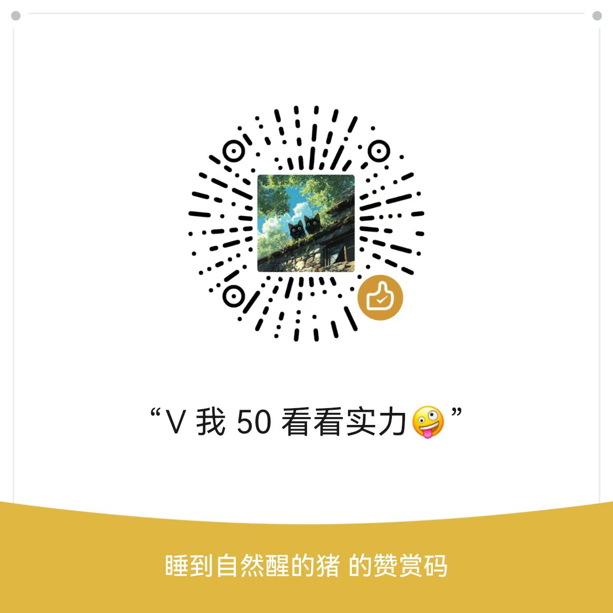

# 山医命相卜（Shan-Yi-Ming-Xiang-Bu）

> 一个以传统「山、医、命、相、卜」五术为骨架的术数象数知识库。本库不做原文转抄，而是把古籍、原典与授课资料重构成**可查、可练、可验证**的体系：每一门都从「板块0 · 学习路径」出发，按板块递进，落到操作流程、自检清单与案例复盘。

## 协议（CC BY 4.0）

### 协议摘要

> 本仓库整理内容采用 **CC BY 4.0（知识共享署名 4.0 国际许可协议）**。
> 您可以自由分享、改编本仓库整理的资料（含商业使用）；分发、二次加工时须**标注来源（BY）**。所引古籍、教材、考纲与官方文件的著作权归原作者与权利人所有，协议仅适用于本仓库的整理汇编成果。

### 完整协议

[CC BY 4.0 知识共享署名 4.0 国际许可协议](https://creativecommons.org/licenses/by/4.0/deed.zh)（全文见 [LICENSE](LICENSE)）

## 请我喝杯咖啡

|     微信赞赏码     |       支付宝        |       支付宝红包        |
| :----------------: | :-----------------: | :-----------------: |
|  | | |
